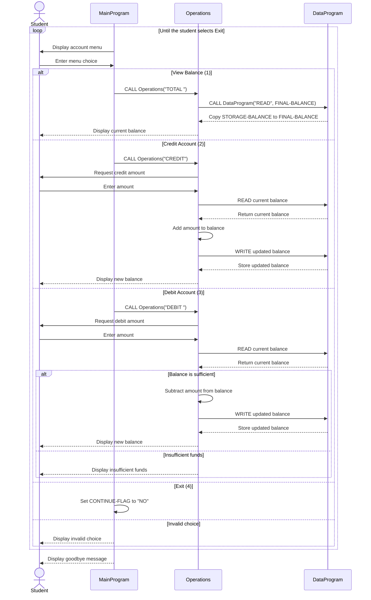

Add COBOL documentation with data flow diagram yozing.
# COBOL Student Account System

This directory documents the COBOL account-management sample in
[`src/cobol/`](../src/cobol/). The program provides a console interface for
viewing and changing a student account balance.

## Program structure

| File | Purpose | Key functions |
| --- | --- | --- |
| [`main.cob`](../src/cobol/main.cob) | Main interactive program and menu controller. | Displays the account menu, accepts a choice, dispatches requests to `Operations`, validates that the choice is 1-4, and exits when the user selects 4. |
| [`operations.cob`](../src/cobol/operations.cob) | Account transaction logic. | Reads and displays the balance (`TOTAL`), credits an entered amount (`CREDIT`), and debits an entered amount when sufficient funds are available (`DEBIT`). |
| [`data.cob`](../src/cobol/data.cob) | Balance storage and data-access boundary. | Handles `READ` requests by copying the stored balance to the caller and `WRITE` requests by replacing the stored balance. |

## Runtime flow

1. `MainProgram` repeatedly displays the menu until the user selects **Exit**.
2. Menu choices call `Operations` with a six-character operation code:
   `TOTAL `, `CREDIT`, or `DEBIT `.
3. `Operations` calls `DataProgram` with `READ` to obtain the current balance.
4. For a credit or valid debit, `Operations` updates the balance and calls
   `DataProgram` with `WRITE`.
5. The updated balance is displayed to the user.

The `PIC 9(6)V99` fields represent a numeric balance with six whole-number
digits and two decimal digits. The implied decimal point is not stored in the
field.

## Student account business rules

The following rules are implemented by the current COBOL programs:

- A new account starts with a balance of **1,000.00**.
- A user may view the current balance.
- A credit increases the balance by the amount entered.
- A debit decreases the balance only when the current balance is greater than
  or equal to the requested amount.
- A debit that exceeds the current balance is rejected with
  `Insufficient funds for this debit.`; the balance is not written.
- The account cannot be overdrawn through the debit path.
- The menu accepts only choices 1 through 4. Other values are rejected and do
  not change the account.
- Selecting **Exit** ends the menu loop; it does not perform an account
  transaction.

## Important implementation notes

- The source does not identify a student number, name, or multiple accounts.
  The documented “student account” is therefore a single account balance.
- No explicit validation prevents zero, negative, or unusually large amounts
  from being entered. COBOL numeric field and input behavior determine how
  those values are handled.
- The balance is held in working storage by `DataProgram`; there is no file or
  database persistence. It is reset to 1,000.00 when the program is started.
- Operation codes are fixed-width six-character values. The spaces in `TOTAL `
  and `DEBIT ` are significant when matching the operation type.

## Application data flow

